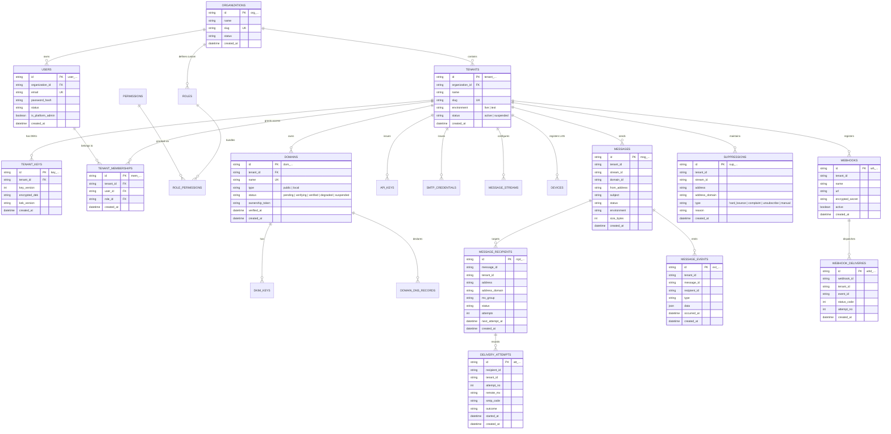

# Mailvex — Database ERD & Schema Design

## 1. Overview & Architectural Constraints

Mailvex targets **MariaDB 11+** (compatible with MySQL 8+). High-volume operational tables are **RANGE partitioned by day/week on `created_at`** to allow instant partition drops for data retention purges without disk fragmentation.

Because MariaDB / MySQL partitioned tables cannot have foreign keys pointing to or from them:
- **Hot partitioned tables** use **Application-Enforced Referential Integrity (App-RI)** managed within `core/repository`.
- **Low-volume configuration tables** use native Foreign Keys (`ON DELETE CASCADE` or `RESTRICT`).

---

## 2. Entity-Relationship Diagram (Mermaid)



---

## 3. Partitioning Strategy

Hot operational tables:
1. `messages`
2. `message_recipients`
3. `message_events`
4. `delivery_attempts`
5. `tracking_events`
6. `webhook_deliveries`
7. `api_request_logs`
8. `inbound_messages`

Partition definition:
```sql
PARTITION BY RANGE (UNIX_TIMESTAMP(created_at)) (
    PARTITION p_2026_09_20 VALUES LESS THAN (UNIX_TIMESTAMP('2026-09-21 00:00:00')),
    PARTITION p_2026_09_21 VALUES LESS THAN (UNIX_TIMESTAMP('2026-09-22 00:00:00')),
    ...
);
```
The `mailvex-scheduler` service runs daily to create partitions 7 days ahead and drop partitions older than the configured retention policy.

---

## 4. Application-Enforced Referential Integrity (App-RI)

To guarantee database consistency across partitioned tables where foreign keys are unsupported:
1. **Transactional Insertion**: `messages`, `message_recipients`, `message_events`, and `outbox` records are inserted within a single database transaction.
2. **Tenant Scoping Guard**: Every query and insert explicitly includes `tenant_id` and verifies parent record existence before child mutation.
3. **Automated Consistency Tests**: CI test suites specifically test for orphan prevention and transaction rollback.
